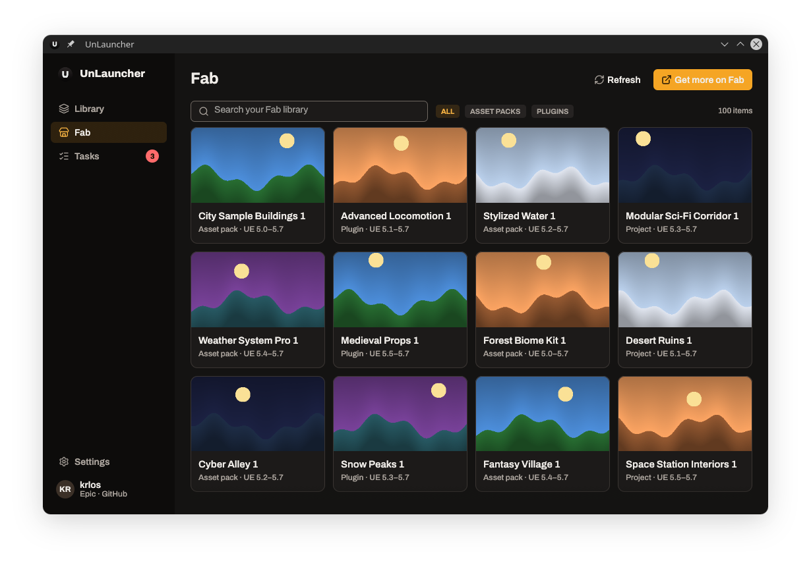
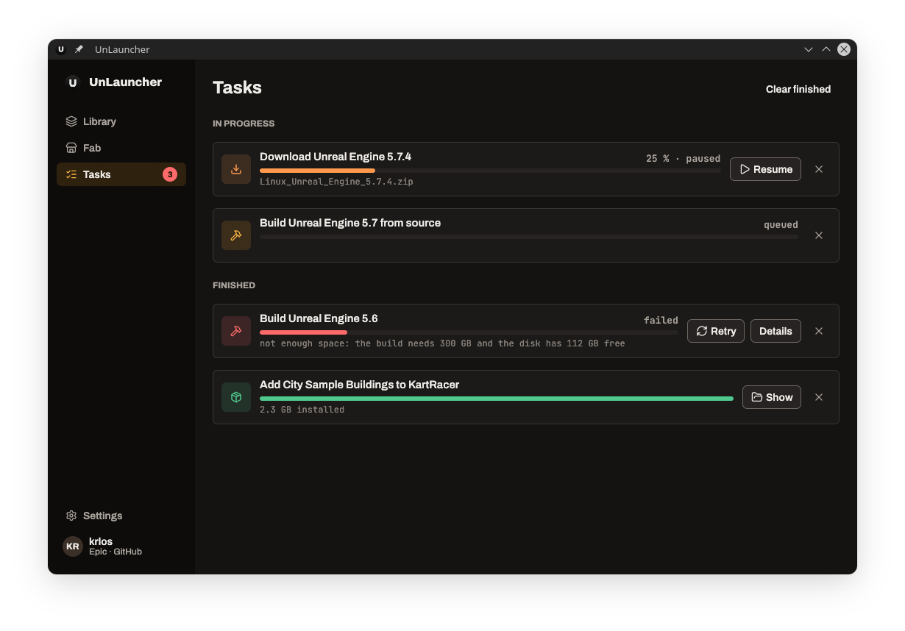

<p align="center">
  
</p>

<p align="center">
  <a href="docs/README.es.md">Español</a>
</p>

<p align="center">
  <a href="https://github.com/krl0sconk/UnLauncher/actions/workflows/ci.yml"></a>
  <a href="LICENSE"></a>
  
  
  
  <a href="https://github.com/krl0sconk/UnLauncher/releases"></a>
</p>

Epic doesn't ship its launcher for Linux. **UnLauncher** is a native one, written in Rust.

## What it does

- **Library** of engines and projects. It reads the same `Install.ini` as the Unreal Editor, so both always agree.
- **Prebuilt engines** from Epic: sign in, pick a version, and UnLauncher downloads, extracts and registers it.
- **Build from source** from the private `EpicGames/UnrealEngine` repository, with a requirements check.
- **Fab library**: browse the assets you own and add them to a project or an engine.
- **Tasks**: downloads, imports and builds with progress, pause and cancel.
- Double-click a `.uproject` to open it with the right engine; add per-engine shortcuts to your application menu.

<table>
  <tr>
    <td></td>
    <td></td>
  </tr>
  <tr>
    <td></td>
    <td></td>
  </tr>
</table>

<!-- demo.gif: docs/assets/demo.gif -->

## 📦 Install

### Flathub (coming soon)

```bash
flatpak install flathub io.github.krl0sconk.UnLauncher
```

### Build from source

You need [rustup](https://rustup.rs) (the Rust version is pinned in `rust-toolchain.toml`), GTK 3 and WebKitGTK 4.1 development files.

<details>
<summary>Dependencies by distribution</summary>

```bash
# Debian / Ubuntu
sudo apt install build-essential pkg-config libgtk-3-dev libwebkit2gtk-4.1-dev

# Fedora
sudo dnf install gcc pkgconf-pkg-config gtk3-devel webkit2gtk4.1-devel

# Arch
sudo pacman -S base-devel gtk3 webkit2gtk-4.1
```

</details>

```bash
git clone https://github.com/krl0sconk/UnLauncher.git
cd UnLauncher
cargo build --release
./target/release/unlauncher
```

##  First use

1. Open UnLauncher. It looks for engines in your home folder and `/opt` and offers to register what it finds. 
2. Open **Library → Install engine**, then choose **Prebuilt** and **List available versions**. Sign in to Epic in the window that opens.
3. Pick a version and an empty destination folder. Follow the download and extraction in **Tasks**.
4. Double-click a project card to open it with its engine.

There is a command-line tool too:

```bash
unlauncher-cli engines list                      # registered engines and those found on disk
unlauncher-cli projects list --path ~/Projects   # projects and their engines
unlauncher-cli --help
```

From a checkout, use `cargo run -p unlauncher-cli -- engines list`. The [user guide](docs/user-guide.md) covers every screen.

## Contributing

Issues and pull requests are welcome. Read [`CONTRIBUTING.md`](CONTRIBUTING.md) first; [`ARCHITECTURE.md`](ARCHITECTURE.md) explains how the code is organized.

## Security

Please report vulnerabilities privately; see [`SECURITY.md`](SECURITY.md).

## License

[GPL-3.0-or-later](LICENSE). Fonts, icons and other third-party material are listed in [`THIRD_PARTY.md`](THIRD_PARTY.md).

---

UnLauncher is not affiliated with or endorsed by Epic Games. Unreal Engine, Fab and Epic Games are trademarks of Epic Games, Inc.
