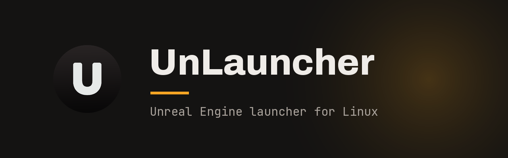
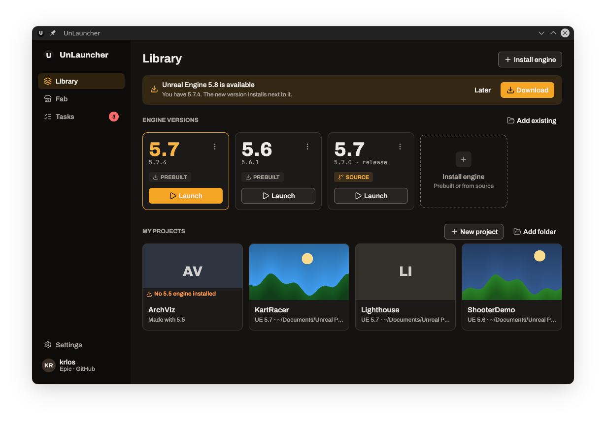

<p align="center">
  
</p>

<p align="center">
  <a href="../README.md">English</a> · Español
</p>

Epic no publica su launcher para Linux. **UnLauncher** es uno nativo, escrito en Rust, para que instalar un motor, abrir un proyecto y traer tus assets de Fab no requiera tocar la terminal.

## Qué hace

- **Biblioteca** de motores y proyectos, con miniaturas. Usa el mismo `Install.ini` que el editor de Unreal, así que ambos siempre coinciden.
- **Motores precompilados** de Epic: inicia sesión, elige una versión y UnLauncher la descarga, extrae y registra.
- **Compilar desde el código** del repositorio privado `EpicGames/UnrealEngine`, con una comprobación de requisitos y sin crear ningún token a mano.
- **Biblioteca de Fab**: tus assets, para agregarlos a un proyecto o a un motor.
- **Tareas**: descargas, importaciones y compilaciones con progreso, pausa y cancelación.
- Doble clic en un `.uproject` para abrirlo con su motor; accesos directos por motor en el menú de aplicaciones.



## Instalar

Flathub (próximamente):

```bash
flatpak install flathub io.github.krl0sconk.UnLauncher
```

Desde el código, con [rustup](https://rustup.rs) (la versión de Rust está fijada en `rust-toolchain.toml`) y los archivos de desarrollo de GTK 3 y WebKitGTK 4.1:

```bash
sudo apt install build-essential pkg-config libgtk-3-dev libwebkit2gtk-4.1-dev   # Debian/Ubuntu
sudo dnf install gcc pkgconf-pkg-config gtk3-devel webkit2gtk4.1-devel           # Fedora
sudo pacman -S base-devel gtk3 webkit2gtk-4.1                                    # Arch

cargo build --release
./target/release/unlauncher
```

La ventana de inicio de sesión de Epic es un programa aparte, `unlauncher-web`: déjalo junto a `unlauncher`.

## CLI

```bash
cargo run -p unlauncher-cli -- engines list                 # motores registrados y encontrados en disco
cargo run -p unlauncher-cli -- engines register <ruta>      # agregar a Install.ini (pide confirmación)
cargo run -p unlauncher-cli -- engines unregister <id>      # quitar de Install.ini (no borra archivos)
cargo run -p unlauncher-cli -- projects list --path <dir>   # proyectos y su motor
cargo run -p unlauncher-cli -- projects associate <.uproject> <id>
```

Toda modificación pide confirmación (o `--yes`) y guarda una copia `*.bak` del archivo anterior. Con `--install-ini <ruta>` se trabaja sobre otro `Install.ini`, útil para probar sin tocar el real.

## Más información

- [Guía de usuario](user-guide.md) (en inglés), [arquitectura](../ARCHITECTURE.md), [permisos del Flatpak](permissions.md).
- [Contribuir](../CONTRIBUTING.md), [seguridad](../SECURITY.md).

## Licencia

[GPL-3.0-or-later](../LICENSE). Las fuentes, iconos y demás material de terceros están en [`THIRD_PARTY.md`](../THIRD_PARTY.md).

---

UnLauncher no está afiliado a Epic Games ni respaldado por ella. Unreal Engine, Fab y Epic Games son marcas registradas de Epic Games, Inc.
